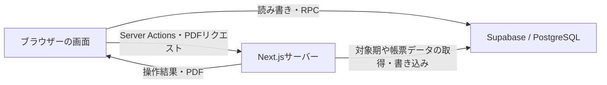

# アーキテクチャ

ブラウザーの画面はNext.jsで動き、SupabaseのPostgreSQLに接続する。仕訳の保存や年度確定ではDBが整合性を検査する。PDFはNext.jsのサーバー側で生成する。

| ページ | 内容 |
| --- | --- |
| [技術スタック](tech-stack.md) | 実行環境、依存バージョン、開発コマンドとCI |
| [ディレクトリ構成](directory-structure.md) | 追跡ファイルの配置と処理を追う入口 |
| [会社スコープ](company-scope.md) | 会社・当期の選択、書き込みと帳票での所属確認 |
| [エラー処理](error-handling.md) | DBエラーの変換、エラー型と画面・APIの通知 |
| [PDF生成](pdf.md) | 9本のルート、帳票データの取得、フォントと文書生成 |
| [セキュリティの現状](security.md) | 接続、権限の境界、利用範囲 |

テーブル・関数・制約は [データベース](../20-database/README.md)、操作と表示は [画面別の機能](../30-features/README.md) を参照。
